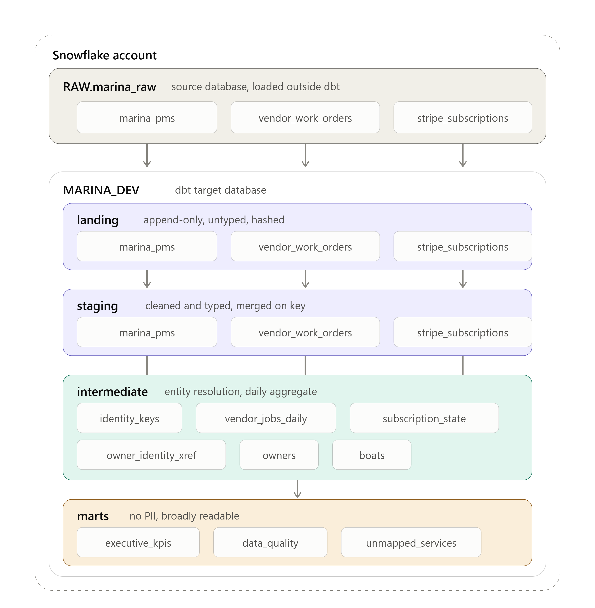
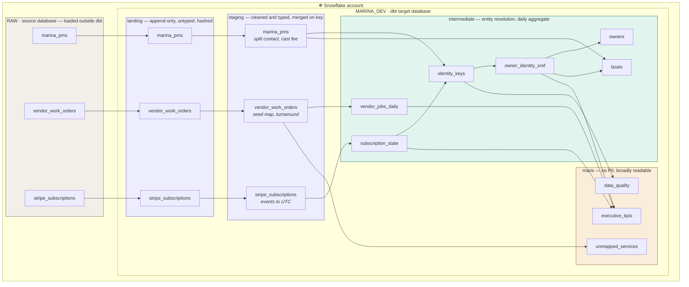

# Marina Platform — dbt

Analytics platform unifying a marina PMS, vendor work orders and Stripe billing into a
governed executive reporting layer.

**Design target: billions of rows.** The case-study sample is eight rows, and this project
runs on it — but every materialization, key strategy and test here is chosen for the volume
the platform is heading toward, not the volume in the CSVs. Where those two disagree, the
comment in the model says so.

Warehouses: Snowflake (primary), BigQuery (supported — dialect branching lives in
`macros/cleaning.sql`).

Target from the brief: `raw_vendor_work_orders` grows 1,000 → 100,000,000 rows. The design
carries headroom past that, but 100M is what it's tuned for.

## Contents

**Architecture & design**
1. [Architecture](#1-architecture)
2. [Landing layer — store raw first](#2-landing-layer--store-raw-first)
3. [What changed from a naive build, and why](#3-what-changed-from-a-naive-build-and-why)
4. [Identity resolution](#4-identity-resolution)
5. [Known data gaps](#5-known-data-gaps)
6. [Warehouse layout](#6-warehouse-layout)
7. [Testing at scale](#7-testing-at-scale)
8. [Security](#8-security)

**Running it**
9. [Environment setup](#9-environment-setup)
10. [Load the source data](#10-load-the-source-data)
11. [Build](#11-build)
12. [Verify — the checks that matter](#12-verify--the-checks-that-matter)
13. [Prove it's incremental](#13-prove-its-incremental)
14. [Documentation](#14-documentation)
15. [Presentation, 20 minutes](#15-presentation-20-minutes)
16. [Answers to have ready](#16-answers-to-have-ready)
17. [Honest limits](#17-honest-limits)

---

## 1. Architecture

At a glance — how the three sources move through the warehouse, from raw landing down to
the marts:



This is the warehouse-layout cut — it shows where each table physically lives (which
database, which schema) rather than which model depends on which. The full model-level
lineage, including the identity-resolution and aggregate hops that every scaling decision is
actually built around, is below.

### Full model lineage




**Raw is stored before anything else happens to it.** Staging never reads a source system
directly — it reads the landing tables, which are a permanent warehouse-local record of what
arrived. See §2.

**The shape that matters:** the mart reads `int_vendor_jobs_daily` and
`int_subscription_state`, never the two billion-row tables. Executive queries are bounded
by the size of the aggregate tier, not by history.

---

## 2. Landing layer — store raw first

Every source is landed before any transformation touches it. Nothing is cast, trimmed,
renamed or filtered: `'$1,200.00'` is stored as `'$1,200.00'`. Four stamps are added and
nothing else:

| Column | Purpose |
|---|---|
| `_row_hash` | Surrogate over the full payload. Idempotency key and version identifier. |
| `_ingested_at` | Arrival time. What staging watermarks on. |
| `_ingestion_date` | Partition key, and the bound on the duplicate anti-join. |
| `_batch_id` | dbt `invocation_id`. Makes a bad load traceable and removable. |

**Why it earns its storage:**

- **Replay.** Any downstream model can be rebuilt from warehouse-local data. Without this,
  a backfill means re-extracting from a source system that may have purged, changed or
  rate-limited since.
- **Audit.** When someone disputes a number, you can show exactly what the source sent and
  when. Cleaning in the first layer destroys that evidence permanently.
- **Change history for free.** Landing is append-only, so a mutable booking lands one row
  per version. Staging takes the latest version per key with a `qualify row_number()`. The
  history is there if anyone later wants slowly-changing dimensions — no snapshot needed.
- **Schema drift survives.** `on_schema_change='append_new_columns'` means a new source
  column lands rather than erroring, and you decide later whether to model it.

**Idempotency** comes from the hash anti-join: re-reading an unchanged row lands nothing, a
changed row lands a new version. The anti-join is bounded by `landing_replay_days` — an
unbounded `NOT EXISTS` against a billion-row table would scan all of it every run.

**Staging watermarks on `_ingested_at`, not on business dates.** This is the payoff: a work
order filed three weeks after the job still gets processed, because the filter asks "what
arrived since last run", not "what happened recently". It replaces the rolling business-date
window v2 used, which was a workaround for not having a landing layer at all.

**Honest scope note.** At billions of rows dbt should not be the thing physically moving the
data. In production these three models become external tables over the loader's Iceberg or
Delta output, with the same four columns stamped by the pipeline. The layer and its contract
stay identical; only the engine changes. Modelling it in dbt here makes the contract explicit
and gives replay on the sample data.

---

## 3. What changed from a naive build, and why

| v1 pattern | Why it fails at scale | This project |
|---|---|---|
| Intermediate and staging as views | Every query re-runs the whole lineage, including regex extraction and three rounds of graph propagation | Everything materialized; staging incremental |
| `row_number() over (partition by sub_id)` for MRR | Sorts the entire event log on every run | `int_subscription_state`, merge-maintained, touches only changed subs |
| Mart stamps `current_date`, rebuilds all | No history, and full recompute daily | Incremental with `metric_date` partitioning; history retained free |
| Staging reads `source()` directly | No replay, no audit of what arrived, and late data handled by guesswork windows | Append-only landing layer; staging watermarks on arrival time |
| Unbounded identity edge list | One poisoned key merges a large share of customers into one owner | Frequency cap in `int_identity_keys` |
| Full resolution every run | Graph job over billions, hours and dollars | Incremental neighbourhood resolution + weekly full rebuild |
| `unique` on every key every run | Full self-join on a billion rows | Scoped to the merged slice; full checks weekly |
| Pre-computed averages in aggregates | Average of daily averages ≠ period average | Additive measures only — sums and counts |

---

## 4. Identity resolution

Records are nodes, a shared normalized contact value is an edge, an owner is a connected
component. Implemented as **label propagation**: each node starts labelled with its own id,
and each round takes `MIN(label)` across every node sharing a key. `MIN` makes the result
independent of scan order, so `owner_id` is stable across rebuilds — unstable keys break
every downstream join.

### Three key types, not two

`raw_contact` holds only one identifier per row, so two records for the same person can
share no contact value at all:

| record | email | phone | hull |
|---|---|---|---|
| BK-901 John Doe | — | 5550192834 | FL8812AB |
| BK-902 J. Doe | jdoe_99@gmail.com | — | FL8812AB |
| SUB-001 | jdoe_99@gmail.com | — | — |

Email and phone alone leave BK-901 with no edge, producing three owners where there are
two. The hull edge closes it. `int_identity_keys` has exactly 3 `hull` rows on the sample
data — one per PMS record — with none flagged poisoned; a live `dbt build` against
Snowflake resolves this to exactly 2 owners, John Doe at `source_record_count = 3`.

**Cost:** hull is a boat-level signal. A sold boat merges two people, and Source A has no
dates to sequence ownership with. Behind `enable_hull_bridging`, with
`int_boats.has_ownership_history` as the guard rail. Time-bounded hull edges are the fix
once booking dates exist.

### The frequency cap

The most important twelve lines in the project. Real contact data contains poisoned keys —
the front-desk phone every walk-in gets typed with, `noreply@`, a QA account. One value in
500k rows makes 500k mutually connected nodes, and propagation merges them into **one owner
holding a large share of the customer base**. It does not error.

Tested on the sample rows plus 40 synthetic walk-ins sharing a front-desk number:

| Cap | Owners | Largest cluster |
|---|---|---|
| none | 2 | **43** — the walk-ins absorbed into a real customer |
| 20 | 42 | 3 — correct |

Poisoned keys are retained with a flag, not dropped, so the polluting values surface in
`mrt_data_quality`. Set the cap from `analyses/profile_identity_key_skew.sql`, not from
this default.

### Incremental resolution

Resolution is globally coupled — one new record can merge two existing clusters — so
"process new rows only" is wrong. Instead: resolve the **neighbourhood** of changed nodes
(the keys they touch, plus every node on those keys, seeded with existing labels) on each
run, and rebuild fully once a week via `is_weekly_full_refresh()`. Assuming incremental
resolution is always exact is how identity tables silently rot.

`identity_resolution_iterations` (default 3) bounds how many hops of shared-key chaining
resolve within a single run. A full refresh reseeds every label from scratch and gets the
same fixed number of rounds — it heals merges the incremental neighbourhood missed, but a
chain longer than the iteration count can still under-merge. `assert_no_contact_maps_to_two_owners`
is the test that catches non-convergence; if it ever fails, raise the iteration count before
assuming the data is wrong.

**Beyond ~50M identities:** replace the propagation CTEs with Spark GraphFrames or a
matching service writing `node_id → owner_id` back into this table. Downstream contracts
are unchanged — which is exactly why the crosswalk is its own model rather than inlined
into `int_owners`.

---

## 5. Known data gaps

Found by profiling the CSVs before any model was written. These are questions for the
source owners, not modelling choices:

1. **Work orders join to nothing.** No `hull_id`, no customer reference. Service cost per
   owner and per boat are unanswerable with this data.
2. **`slip_fee` equals `mrr_amount` for both customers.** Either the annual plan's
   `mrr_amount` is a yearly total (real MRR 100, company MRR 2,600) or the column name is
   accurate (MRR 3,700). A 30% swing on the headline metric, with the column name as the
   only evidence. Default takes the name at face value; `annual_plan_amount_is_annual_total`
   flips it.
3. **Timestamps are naive.** No offset, no timezone column. "Standardize to UTC" is not
   actually possible; the current parse assumes UTC and a multi-market platform needs a
   source-timezone column.
4. **Neither hull ID is a valid 12-char HIN.** These are internal registration codes, so
   the length check is set from profiled data, not the ISO spec.

---

## 6. Warehouse layout

**Snowflake:** cluster `stg_vendor_work_orders` on `(vendor_name, status)` — what the
scorecard filters on. `incremental_predicates` bound the MERGE scan to recent target
partitions; without it the merge scans the whole destination.

**BigQuery:** daily partitions on `created_at_utc` (~2.7M rows/partition at 5B over 5
years — a sensible file target; monthly is too coarse, hourly makes too many files), same
clustering, and `require_partition_filter` so one unfiltered `count(*)` is an error rather
than a bill.

**At 1B+:** open table format (Iceberg/Delta) for partition evolution, compaction control
and a single physical copy shared between Spark and the warehouse. Cleaning moves into the
ingestion job and staging becomes rename-and-type only. Backfills run as orchestrated
microbatches over partition ranges; `--full-refresh` on the fact tables gets blocked in
prod.

---

## 7. Testing at scale

Assertion on every row stops being affordable, so the strategy shifts:

- **Scoped uniqueness** — `unique` tests carry a `where` bounding them to the merged slice.
- **Full-table integrity** — weekly, off-peak, on a dedicated warehouse.
- **Reconciliation** — `assert_daily_aggregate_matches_source` proves the aggregate tier
  agrees with the fact table it summarizes. Aggregates drifting from source is how a mart
  becomes confidently wrong.
- **Blast-radius guards** — `assert_identity_cluster_size_sane` errors if any owner absorbs
  more than 1% of nodes. This is the alarm for a bypassed frequency cap.
- **Observation over assertion** — `mrt_data_quality` tracks failing *rates* daily, which is
  what a human actually reviews.
- **Severity discipline** — error means the data is wrong; warn means the world is messy.
  `store_failures` with `limit: 5000` so the failures table isn't its own scale problem.

A full `dbt build` runs 5 custom reconciliation/convergence/blast-radius tests on top of the
generated schema tests — zero warnings, zero errors on the sample data.

---

## 8. Security

PII is tagged per column (`pii_type`, `masking_required`, `masking_strategy`,
`retention_days`, `masking_policy`) in `schema.yml`, so the catalog and the masking DDL come
from one source of truth.

**Masking is wired, not just documented.** `macros/mask_pii.sql` defines three Snowflake
masking policies — `marina_name_mask`, `marina_email_mask`, `marina_phone_mask` — created by
`create_pii_masking_policies()` as an `on-run-start` hook, then bound to columns via
`apply_masking_policy()` as a `post_hook` on every model with a cleanly-typed PII column
(`stg_marina_pms`, `stg_stripe_subscriptions`, `int_owner_identity_xref`, `int_owners`).
Unmasked visibility is gated by `IS_ROLE_IN_SESSION(var('pii_unmasked_role'))`, so one var
controls who sees clear text. All of it is gated to `target.type == 'snowflake' and
target.name == 'prod'` — a no-op in dev and on BigQuery, which is how a `dbt build` against a
dev target stays fast and side-effect-free while still exercising the same hook path.

`int_identity_keys.key_value` is deliberately **not** column-masked: it mixes email, phone
and hull values under one type-tagged column, and a single Snowflake masking policy can't
apply email-shaped masking to some rows and hull-shaped masking to others. PII exposure
there is bounded by restricted schema access instead — see the model's header comment.

BigQuery uses Data Catalog policy tags for the equivalent behavior.

Staging and intermediate are restricted schemas; marts are broadly readable and **contain no
PII**, so the widest-access layer is the safest.

Deletion requests resolve through `int_owner_identity_xref`: one `owner_id` yields every
source record for that person across both systems.

---

## 9. Environment setup

### 9.1 Prerequisites

- Python 3.9+
- A Snowflake account. A 30-day trial at `signup.snowflake.com` is enough — no card.

### 9.2 Virtual environment

```powershell
cd marina_platform
python -m venv .venv
.venv\Scripts\Activate.ps1
```

If PowerShell blocks the activation script:

```powershell
Set-ExecutionPolicy -Scope CurrentUser -ExecutionPolicy RemoteSigned
```

Command Prompt uses `.venv\Scripts\activate.bat`; macOS and Linux use
`source .venv/bin/activate`. The prompt shows `(.venv)` once active.

### 9.3 Install

```powershell
pip install dbt-core dbt-snowflake
dbt --version
```

`dbt-snowflake` is the **adapter** — the connector that lets dbt talk to Snowflake. dbt
Core has no database connectivity of its own. Swap it for `dbt-bigquery` or
`dbt-databricks` to target a different warehouse.

### 9.4 Gather the Snowflake values

Log into Snowsight and collect five things:

| Value | Where to find it |
|---|---|
| `account` | The browser URL. `https://app.snowflake.com/myorg/ab12345` → `myorg-ab12345` (hyphen, not slash). Or the account selector → Copy account identifier. |
| `user` | Bottom-left in Snowsight, or `select current_user();` |
| `role` | `select current_role();` — a trial gives `ACCOUNTADMIN` |
| `warehouse` | `show warehouses;` — a trial creates `COMPUTE_WH` |
| `database` | `MARINA_DEV` — created by the load script in §10 |

### 9.5 Create the profile

dbt reads `profiles.yml`, which holds credentials and therefore **never belongs in git**.
Create it in a `.dbt` folder inside the project and point dbt at it:

```powershell
mkdir .dbt -Force
copy profiles.example.yml .dbt\profiles.yml
$env:DBT_PROFILES_DIR = "$PWD\.dbt"
code .dbt\profiles.yml
```

`.gitignore` already excludes `.dbt/`, `profiles.yml`, and `.env` — confirm before ever
running `git add`:

```powershell
Select-String -Path .gitignore -Pattern "profiles|\.dbt"
```

`.gitignore` only prevents *future* tracking — once a password is committed it is in
history, and the only real fix is rotating it.

The absolute path in `DBT_PROFILES_DIR` means dbt finds the profile regardless of which
directory the terminal is in. It lasts for the current terminal session; to persist it:

```powershell
[Environment]::SetEnvironmentVariable("DBT_PROFILES_DIR", "$PWD\.dbt", "User")
```

### 9.6 Fill it in

Replace the file contents entirely with the values from §9.4:

```yaml
marina_platform:
  target: dev
  outputs:
    dev:
      type: snowflake
      account: myorg-ab12345
      user: YOUR_USERNAME
      password: YOUR_PASSWORD
      role: ACCOUNTADMIN
      database: MARINA_DEV
      warehouse: COMPUTE_WH
      schema: dbt_yourname      # where your models build; anything unique to you
      threads: 8
```

Three things that break this, all seen in practice:

- **`authenticator: externalbrowser`** fails on a trial with
  `There was an error related to the SAML Identity Provider`. That setting is for corporate
  SSO. Use `password` instead.
- **Missing `database`** gives `'database' is a required property`.
- **Leaving the `prod` / `bigquery_prod` blocks in place** fails on their `env_var()` calls
  even though you are not using those targets. Delete them.

If MFA is enforced on the account, add `authenticator: username_password_mfa` alongside the
password — it caches the token so you approve once per session rather than per model.

### 9.7 Verify

```powershell
dbt deps          # installs dbt_utils — nothing compiles without it
dbt debug         # must end with: All checks passed!
```

`dbt debug` prints the exact `profiles.yml` path it used. Check that line matches the file
you edited — a mismatch here is the most common setup failure.

---

## 10. Load the source data

Run `sample_data/load_snowflake.sql` in a Snowsight worksheet, top to bottom. It creates
`RAW.marina_raw` with the three tables, and `MARINA_DEV` for dbt to build into.

Then verify the load. Every downstream claim depends on these three:

```sql
select booking_id, raw_contact, slip_fee from RAW.marina_raw.raw_marina_pms;
select work_order_id, (completed_at is null) from RAW.marina_raw.raw_vendor_work_orders;
```

- `slip_fee` on BK-901 still reads `$1,200.00` — symbol and comma intact
- `raw_contact` holds a phone on BK-901, an email on BK-902
- WO-103 `completed_at` is NULL, not an empty string

A silent failure here produces plausible output from broken input.

---

## 11. Build

```powershell
dbt seed
dbt build
```

`dbt build`, not `dbt run` — `run` skips the tests, and the tests are where identity
resolution gets validated.

### Layer by layer, if inspecting as you go

```powershell
dbt build --select tag:landing --exclude tag:reconciliation
dbt build --select tag:staging
dbt build --select tag:intermediate
dbt build --select tag:marts
dbt test  --select tag:reconciliation      # needs every layer present
```

Reconciliation tests (`assert_daily_aggregate_matches_source`,
`assert_landing_covers_staging`) span two layers each. dbt's default indirect test
selection pulls a test in if *any* of its ancestors match the `--select`, so running
`tag:landing` alone on a genuinely empty target will try to run a test against a staging
table that doesn't exist yet — hence the `--exclude`. A full `dbt build` runs them normally,
once everything exists.

To land data without rebuilding everything downstream:

```powershell
dbt run --select tag:landing        # store raw only
dbt build --select tag:landing+     # land, then everything that depends on it
```

---

## 12. Verify — the checks that matter

**Landing kept the raw values**
```powershell
dbt show --inline "select booking_id, slip_fee, _row_hash, _ingested_at from {{ ref('raw_marina_pms') }}"
```
`slip_fee` still `$1,200.00`. If it is numeric, something cast it and the audit claim is false.

**Staging split raw_contact**
```powershell
dbt show --inline "select booking_id, customer_email, customer_phone, contact_type, hull_id from {{ ref('stg_marina_pms') }}"
```
BK-901 phone-only, BK-902 email-only, both hulls `FL8812AB`.

**Identity resolution — THE GATE**
```powershell
dbt show --inline "select legal_name, primary_email, primary_phone, source_record_count from {{ ref('int_owners') }}"
```
**Two rows. John Doe at `source_record_count = 3`.**
Three rows means hull bridging did not fire — check `int_identity_keys` has 3 `hull` rows,
none flagged poisoned. Nothing downstream is trustworthy until this passes.

**Boats**
```powershell
dbt show --inline "select hull_id, boat_name, booking_count, has_name_variants from {{ ref('int_boats') }}"
```
Two rows. `FL8812AB` / `Sea Breeze` / 2 bookings / `has_name_variants = true`.

**The three required metrics**
```powershell
dbt show --inline "select metric_name, metric_value from {{ ref('mrt_executive_kpis') }} where metric_domain = 'Revenue'"
dbt show --inline "select grain_value, metric_name, metric_value from {{ ref('mrt_executive_kpis') }} where metric_grain = 'period'" --limit 20
```

| Metric | Expected |
|---|---|
| MRR | 3,700 |
| ARR | 44,400 |
| Avg turnaround (period, All Vendors) | 4.75 h |
| Hours per logged job (period) | 3.17 |

---

## 13. Prove it's incremental

The first build is always a full refresh, so incremental logic never executed. This is
where case studies quietly fail.

```powershell
dbt build
dbt build
```

Row counts must not change on the second run. Landing growing means the content-hash
anti-join is broken; staging growing means a watermark is wrong.

```powershell
dbt show --inline "select count(*) as n from {{ ref('stg_vendor_work_orders') }}"
```
Still 3.

Then compile and read the SQL — the most convincing artefact for an engineering panel:

```powershell
dbt compile --select stg_vendor_work_orders
```

Open `target/compiled/.../stg_vendor_work_orders.sql`. Be able to point at the `merge`, the
rolling lookback predicate, and the partition/cluster config, and explain each in one
sentence.

---

## 14. Documentation

```powershell
dbt docs generate
dbt docs serve          # http://localhost:8080
```

The lineage graph is deliverable #2 — a generated graph beats a drawn diagram because the
dependencies are real. Have this open in a tab during the presentation, alongside:

- **`mrt_data_quality`** — failing rates per check
- **PII metadata** in `models/staging/schema.yml` — `pii_type`, `masking_required`,
  `retention_days`, and the fact that marts hold none

---

## 15. Presentation, 20 minutes

| Min | Content |
|---|---|
| 2 | Results — MRR 3,700 · ARR 44,400 · 4.75h turnaround · 5 records → 2 owners |
| 2 | Architecture DAG |
| 6 | Identity resolution, including the poisoned-key failure |
| 3 | Testing |
| 3 | Scaling to 100M |
| 2 | PII and governance |
| 2 | Assumptions and next steps |

Two tabs: the deck, and VS Code with `int_owner_identity_xref.sql` open. When asked how
matching works, switch to the code.

Live demo, ten seconds: `dbt show` on `int_owners` returning 2 rows.

---

## 16. Answers to have ready

| Question | Answer |
|---|---|
| Partitioning | Daily on `created_at_utc` (BigQuery); Snowflake prunes on load order + clustering |
| Clustering | `(vendor_name, status)` — what the scorecard filters on |
| Incremental | `merge` on `work_order_id`, rolling lookback for late paperwork, `incremental_predicates` to bound the target scan |
| Why not views | At 100M a view re-executes regex extraction and graph propagation per query |
| MRR at scale | Never a window over the full event log — `int_subscription_state` is merge-maintained |
| Dashboard cost | Reads `int_vendor_jobs_daily`; additive measures only |
| Identity past 100M | Frequency cap against key poisoning; incremental neighbourhood resolution with weekly rebuild; Spark GraphFrames past ~50M identities, same contract |
| Why `sub_id` is not unique | Stripe is an append-only log; uniqueness sits on `sub_event_id` |
| PII masking | Three Snowflake masking policies, role-gated, bound via `post_hook`; `on-run-start` creates them, gated to prod so dev builds stay side-effect-free |
| How long did this take | Longer than 2.5 hours. Say so, and say the scaling work was the interesting part. |

---

## 17. Honest limits

- Incremental identity resolution can miss merges spanning beyond the changed
  neighbourhood. The weekly rebuild heals them; `assert_no_contact_maps_to_two_owners`
  detects them in between.
- Percentile metrics (p90 turnaround) are absent from the aggregate tier because
  percentiles are not additive. They need the raw table on a bounded window or a mergeable
  sketch.
- Historical MRR needs a daily snapshot of subscription state. This build reports MRR today
  and vendor operations by day.
- The masking policies are correct Snowflake DDL and have been parse-validated and exercised
  against a live `dev` target (where they correctly no-op), but haven't been exercised
  against a real prod-role hierarchy — confirm `IS_ROLE_IN_SESSION` and the policy grant
  model against your actual roles before relying on them in a live account.
